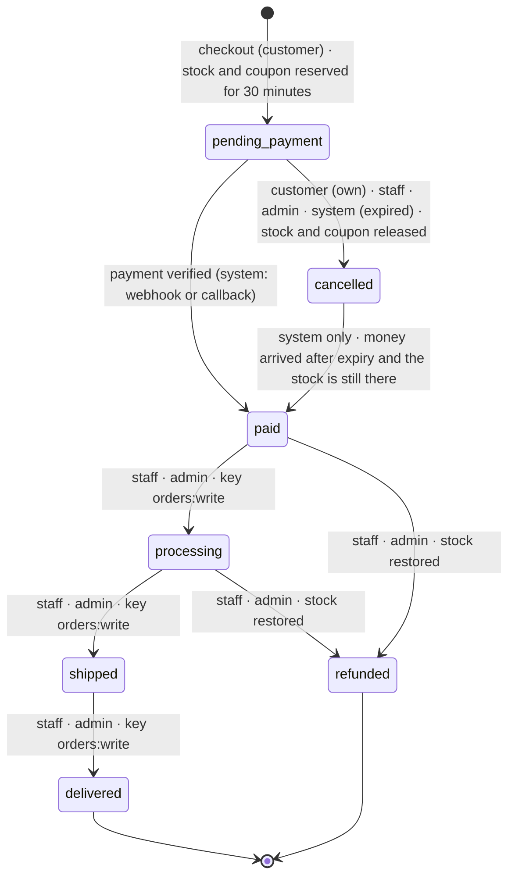
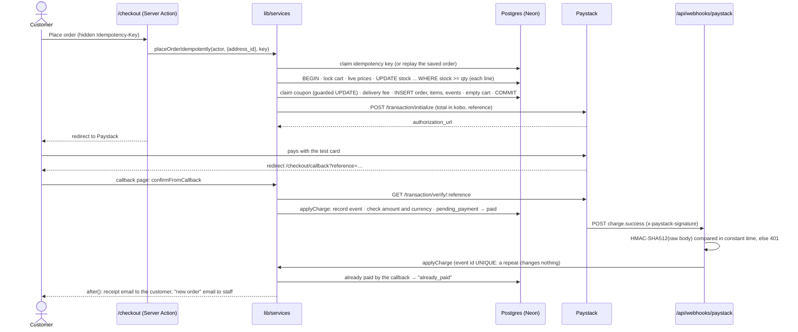
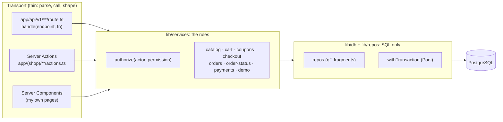

# Ọjà

**Ọjà** ("market" in Yoruba) is the backend of a leather-goods brand from Aba: shoes, bags, belts and sandals cut and stitched in the workshops of Ariaria market and sold across Nigeria. It is a **versioned REST API** (`/api/v1`) that a phone app, a courier's system or another website can use, plus a thin storefront and admin built on top of the same code to prove it works.

- **Customers** sign up, browse and filter the catalogue, keep a cart, save delivery addresses, apply a coupon and pay with Paystack (test mode). They follow each order's status on a timeline.
- **Staff** manage products, variants (size × colour, each with its own SKU, price and stock) and images, and move orders from paid to processing, shipped and delivered.
- **Admins** also manage coupons, delivery fees for all 36 states and the FCT, users and roles, API keys, and read the Paystack webhook log.

Day 20 of a 30-day build challenge. The focus is **backend design for products, orders and users**:

- API keys with scopes
- cursor pagination
- one error format (RFC 9457 problem+json)
- idempotent order creation
- an order state machine
- coupons that can't be over-used
- stock that can't be oversold
- Paystack webhooks verified on the server
- an OpenAPI 3.1 document generated from the same Zod schemas the routes validate with

Built with Next.js 16 (App Router, Cache Components), TypeScript (strict, `noUncheckedIndexedAccess`), Tailwind CSS v4, PostgreSQL on Neon (plain SQL, no ORM), Zod and Resend. Paystack is called with `fetch`. There are no ORM, auth, UI, form, state or API-framework libraries.

---

- [Run it locally](#run-it-locally)
- [Demo logins](#demo-logins)
- [Deploy to Vercel](#deploy-to-vercel)
- [Four diagrams](#four-diagrams)
- [Three layers](#three-layers)
- [The database](#the-database)
- [The API](#the-api)
- [Orders, stock and coupons](#orders-stock-and-coupons)
- [Payments](#payments)
- [Who can do what](#who-can-do-what)
- [Ownership checks](#ownership-checks)
- [EXPLAIN: the product list and the order lists](#explain-the-product-list-and-the-order-lists)
- [Demo mode](#demo-mode)
- [What changed when reusing the Day 17 auth](#what-changed-when-reusing-the-day-17-auth)
- [Design and accessibility](#design-and-accessibility)
- [Concepts and where they live](#concepts-and-where-they-live)
- [Not built (yet)](#not-built-yet)

---

## Run it locally

You need Node 22.18 or newer and a free [Neon](https://neon.tech) project.

1. **Install:** `npm install`
2. **Environment:** copy `.env.example` to `.env.local` and fill it in:
   - `DATABASE_URL`: the **pooled** connection string. In Neon, open Connect and turn "Connection pooling" on; the host contains `-pooler`.
   - `DATABASE_URL_UNPOOLED` (optional): the direct string. Migrations, the seed and EXPLAIN prefer it.
   - `APP_URL`: `http://localhost:3020` locally. Email links and Paystack's callback URL are built from it.
   - `PAYSTACK_SECRET_KEY` and `PAYSTACK_PUBLIC_KEY`: your **test** keys, from the Paystack dashboard (Settings → API Keys & Webhooks, test mode). Without them everything works except paying.
   - `CRON_SECRET`: a long random string, e.g. `node -e "console.log(crypto.randomBytes(32).toString('hex'))"`.
   - `SEED_ADMIN_PASSWORD`, `SEED_STAFF_PASSWORD`, `SEED_CUSTOMER_PASSWORD`: 8 to 128 characters each.
   - `RESEND_API_KEY` and `EMAIL_FROM` (optional): without them every email (verification links, receipts) is printed in the terminal.
   - `DEMO_MODE` and `DEMO_API_KEY` (optional): see [Demo mode](#demo-mode).
   - `SMOKE_API_KEY`: for `npm run api:smoke`. Create one on `/admin/api-keys` after seeding.
3. **Create the tables:** `npm run db:migrate`. Run it again any time; with nothing new it does nothing.
4. **Fill the shop:** `npm run db:seed`. It's safe to run twice; the second run changes nothing.
5. **Start:** `npm run dev`, then open <http://localhost:3020>. (Port 3020, so it can run next to the other days' apps.)

| Script | What it does |
| --- | --- |
| `npm run db:migrate` | Applies new files in `db/migrations/` in order, each in its own transaction, recorded in `schema_migrations` |
| `npm run db:seed` | Accounts, 24 products with variants, 3 coupons, addresses, ~40 orders in every status over the past month, demo accounts, the demo API key |
| `npm run db:explain` | Query plans for the product list and the order lists, on the seed and again with 20,000 products and 40,000 orders (rolled back) |
| `npm run api:smoke` | Runs the main API flows against a running server and prints PASS/FAIL for each |
| `npm run check:contrast` | Checks 48 colour pairs in both themes against WCAG AA |
| `npm run typecheck` | Regenerates route types, then `tsc --noEmit` |

**Paystack test card:** `4084 0840 8408 4081`, any future expiry, CVV `408`, PIN `0000`, OTP `123456`.

**Locally, payments are confirmed by the callback page**, not the webhook: Paystack can't reach `localhost`. See [Payments](#payments).

## Demo logins

After `npm run db:seed`, every account has a confirmed email. The passwords come from your `.env.local`; they are never in the code.

| Email | Role | Password from |
| --- | --- | --- |
| `admin@example.com` (Chiamaka) | admin | `SEED_ADMIN_PASSWORD` |
| `staff@example.com` (Emeka) | staff | `SEED_STAFF_PASSWORD` |
| `customer@example.com` (Adaeze, addresses in Aba and Enugu) | customer | `SEED_CUSTOMER_PASSWORD` |
| `tunde@`, `ngozi@`, `ibrahim@`, `funke@example.com` | customer | `SEED_CUSTOMER_PASSWORD` |

**Coupons:**

- `ABA10` is active: 10% off orders of ₦30,000 or more, once per customer.
- `SALLAH2026` expired in June.
- `FIRST50` is used up (50 of 50).

## Deploy to Vercel

1. Push the repository to GitHub and import it in Vercel. The framework is detected automatically.
2. Add the environment variables below in **Settings → Environment Variables**.
3. Run the migrations and the seed against the production database once, from your machine: put its URL in `.env.local`, then run `npm run db:migrate` and `npm run db:seed`.
4. **Webhook:** in the Paystack dashboard (test mode), set the webhook URL to `https://<your-app>.vercel.app/api/webhooks/paystack`.
5. **Cron:** `vercel.json` schedules `GET /api/cron/expire-orders` daily at 03:00 UTC. Vercel sends `Authorization: Bearer $CRON_SECRET`; anyone else gets 401. Settings → Cron Jobs shows it after the first deploy.

| Variable | Required | Value |
| --- | --- | --- |
| `DATABASE_URL` | yes | Neon **pooled** connection string |
| `DATABASE_URL_UNPOOLED` | no | Neon direct string (only the scripts use it) |
| `APP_URL` | yes | e.g. `https://oja.vercel.app`, no trailing slash. Email links and the Paystack callback are built from it, never from the request's Host header |
| `PAYSTACK_SECRET_KEY` | for payments | `sk_test_…`. Signs our calls to Paystack and checks its webhook signatures |
| `PAYSTACK_PUBLIC_KEY` | no | `pk_test_…`. Not used by the server-side redirect flow, but kept with its pair |
| `CRON_SECRET` | yes | At least 16 random characters |
| `RESEND_API_KEY` | no | Without it, emails go to the function logs |
| `EMAIL_FROM` | with Resend | e.g. `Ọjà <orders@your-domain.ng>`, on a domain verified in Resend |
| `DEMO_MODE` | no | `true` turns on the demo buttons, banner and demo key; anything else turns them off |
| `DEMO_API_KEY` | with demo mode | `oja_live_` followed by 43 base64url characters. The seed stores its hash; /docs prints it |
| `SEED_ADMIN_PASSWORD`, `SEED_STAFF_PASSWORD`, `SEED_CUSTOMER_PASSWORD` | for the seed | Only used on your machine |
| `SMOKE_API_KEY` | for the smoke test | Only used on your machine |

---

## Four diagrams

### 1. The database

```mermaid
erDiagram
    users ||--o{ sessions : "CASCADE"
    users |o--o{ auth_events : "SET NULL"
    users ||--o| carts : "CASCADE"
    users ||--o{ addresses : "CASCADE"
    users |o--o{ orders : "SET NULL (demo cleanup only)"
    users ||--o{ api_keys : "created_by RESTRICT"
    categories ||--o{ products : "RESTRICT"
    products ||--o{ product_variants : "CASCADE (blocked once ordered)"
    products ||--o{ product_images : "CASCADE"
    carts ||--o{ cart_items : "CASCADE"
    product_variants ||--o{ cart_items : "CASCADE"
    coupons |o--o{ carts : "SET NULL"
    delivery_fees ||--o{ addresses : "state RESTRICT"
    orders ||--o{ order_items : "CASCADE"
    product_variants ||--o{ order_items : "RESTRICT"
    orders ||--o{ order_events : "CASCADE"
    users |o--o{ order_events : "actor SET NULL"
    api_keys |o--o{ order_events : "actor SET NULL"
    coupons ||--o{ coupon_redemptions : "RESTRICT"
    orders ||--o| coupon_redemptions : "CASCADE"
    orders |o--o{ payment_events : "SET NULL"

    users { uuid id PK; citext email UK; text role; text password_hash "NULL only for demo"; bool is_demo }
    products { bigint id PK; text slug UK; smallint category_id FK; text status; tsvector search; bigint price_from_kobo; bool in_stock; int version }
    product_variants { bigint id PK; bigint product_id FK; text sku UK; text size; text colour; bigint price_kobo; bigint compare_at_price_kobo; int stock; int version }
    orders { bigint id PK; text number UK; uuid customer_id FK; text status; bigint subtotal_kobo; bigint discount_kobo; bigint delivery_fee_kobo; bigint total_kobo; text ship_fields "copied"; text paystack_reference UK; timestamptz expires_at; int version }
    order_items { bigint id PK; bigint order_id FK; bigint variant_id FK; text product_name "copied"; text sku "copied"; bigint unit_price_kobo "copied"; int quantity }
    order_events { bigint id PK; bigint order_id FK; text type; text from_status; text to_status; text actor_label }
    coupons { bigint id PK; citext code UK; text kind; bigint value; int max_uses; int uses; int per_customer_limit }
    api_keys { uuid id PK; text prefix UK; text key_hash UK; text_arr scopes; timestamptz revoked_at }
    idempotency_keys { bigint id PK; text owner; text endpoint; text key; text request_hash; jsonb response_body }
    payment_events { bigint id PK; text event_id UK; text source; text outcome }
```

### 2. The order state machine



Every allowed move is one row in `TRANSITIONS` in [`lib/services/order-status.ts`](lib/services/order-status.ts): from, to, who may make it, and what else happens (release, restock, retake). Any other move is **409 invalid_transition**, with `allowed_next` in the answer. The admin page offers only the moves in the table, and so does the API's `next_statuses` field. Every move writes an `order_events` row in the same transaction ([`lib/services/order-moves.ts`](lib/services/order-moves.ts)).

### 3. Checkout, from "Place order" to the webhook



### 4. The three layers



## Three layers

1. **`lib/db` and `lib/repos`: SQL only, no business rules.**
   - `lib/db/sql.ts` builds parameterised fragments (q\`… ${value}\`) that nest, and never pastes a value into SQL text.
   - `lib/db/executor.ts` runs a fragment either as one HTTPS request (`http`) or inside an interactive transaction (`lib/db/tx.ts`, Neon's WebSocket `Pool`).
   - Every repo function takes that `db` as its first argument, so the **service** decides which calls share a transaction.
   - Every row is parsed with Zod (bigint columns arrive as strings and are converted only if they fit exactly in a number).
2. **`lib/services`: the rules.**
   - Pricing, stock, coupons, order moves, ownership, and who may do what.
   - Every function takes the **actor** first: a user, an API key, the system, or anonymous ([`lib/services/actor.ts`](lib/services/actor.ts)).
   - Services never see a request, a cookie or a header. They throw typed `ServiceError`s (`not_found`, `conflict`, `invalid`, …) and never build HTTP responses.
3. **Transport: thin.** Parse the input with Zod, call **one** service, and shape the answer:
   - **`app/api/v1/**`** route handlers, all wrapped by `handle()` ([`lib/api/handler.ts`](lib/api/handler.ts)), which maps errors to problem+json;
   - **Server Actions**, which turn the same errors into form messages ([`lib/action-helpers.ts`](lib/action-helpers.ts) `fromServiceError`);
   - **Server Components** for my own pages.

**My pages call the services directly, never my own API over HTTP.** A server fetching from itself would:

- add a network hop for nothing;
- need the session cookie forwarded by hand;
- lose the TypeScript types at the JSON boundary;
- split one request into two, with two logs and two places to fail.

Because both paths reach the same services, the rules can't differ between the website and the API. The admin's "Mark shipped" button and `POST /api/v1/orders/42/transitions` run the same function.

## The database

Numbered SQL migrations in `db/migrations`:

- `001`–`005` are Day 17's auth tables, unchanged.
- `006` adds roles and demo accounts.
- `007` is the catalogue.
- `008` is delivery fees (all 37 rows; reference data belongs in the migration, not the seed) and addresses.
- `009` is coupons, `010` carts, `011` API keys.
- `012` is orders, items, events and redemptions.
- `013` is payment events and idempotency keys.

**Every table, column, constraint and index has a comment in its migration saying why it exists.** The highlights:

- **Money is `bigint` kobo** everywhere, with CHECKs (`price_kobo >= 0`, a "was" price higher than the price).
  - `CONSTRAINT orders_total_adds_up CHECK (total_kobo = subtotal_kobo - discount_kobo + delivery_fee_kobo)` makes a wrongly-added order unsaveable.
- **`stock CHECK (stock >= 0)`** is the last line of defence behind the guarded UPDATE.
- **`coupons CHECK (max_uses IS NULL OR uses <= max_uses)`** does the same for coupon uses.
- **One default address per customer:** a partial unique index, `ON addresses (customer_id) WHERE is_default`.
- **Coupon codes are `citext`**, so `ABA10`, `aba10` and `Aba10` are one code, both in the UNIQUE rule and when typed.
- **`products.search`** is a generated `tsvector` (name weighted A, description B) with a GIN index, as on Day 16.
- **`products.price_from_kobo` and `in_stock`** are kept up to date from the variants by a trigger. That makes "sort by price" and "in stock only" an index scan with a stable cursor key. The trigger only writes when a value changes, so most sales never touch the product row.
- **`order_events` is append-only:** a trigger refuses UPDATE, and refuses DELETE unless it comes from the order's own cascade (`pg_trigger_depth()`).
- **`updated_at`** is set by Day 17's trigger on every mutable table.

### Why order lines copy the name and the price

`order_items` stores `product_name`, `variant_label`, `sku` and `unit_price_kobo` **as they were at checkout**, and `orders` stores the shipping address the same way. Next month the loafer may cost more, be renamed or be archived, and the customer may move house. The receipt, the packing slip and the sales figures must still say what was sold, at what price, and where it went. A join would rewrite history every time the catalogue changed.

### ON DELETE, chosen one by one

| Foreign key | Rule | Why |
| --- | --- | --- |
| `sessions`, `email_tokens`, `carts`, `addresses` → `users` | CASCADE | The user's own data, meaningless without them (only demo customers are ever deleted) |
| `orders.customer_id` → `users` | SET NULL | Real users are deactivated, never deleted; when a 24-hour demo customer is cleaned up, their **paid** orders stay in the books, flagged `is_demo` |
| `order_items.variant_id` → `product_variants` | RESTRICT | A sold variant can't be deleted, only archived. This also stops its product being hard-deleted |
| `product_variants`, `product_images` → `products` | CASCADE | Parts of the product; a never-ordered draft can be deleted cleanly |
| `products.category_id` → `categories` | RESTRICT | Don't strand products |
| `addresses.state` → `delivery_fees` | RESTRICT | An address can only name a state we deliver to, and the fee lookup can't miss |
| `cart_items.variant_id` → `product_variants` | CASCADE | A deleted (never-ordered) variant just drops out of carts |
| `carts.coupon_id` → `coupons` | SET NULL | A deleted unused coupon simply leaves the cart |
| `coupon_redemptions.coupon_id` → `coupons` | RESTRICT | A used coupon is history: pause it instead |
| `order_items`, `order_events`, `coupon_redemptions` → `orders` | CASCADE | Parts of the order (only unpaid demo orders are deleted) |
| `order_events` actor → `users` / `api_keys` | SET NULL | The event survives; `actor_label` was copied |
| `api_keys.created_by` → `users` | RESTRICT | Always know who made a key |
| `payment_events.order_id` → `orders` | SET NULL | The webhook log outlives a cleaned-up demo order |

---

## The API

Base URL `/api/v1`. The OpenAPI 3.1 document is at **`/api/v1/openapi.json`**. **`/docs`** is the readable reference, built from that document (no Swagger UI): grouped by resource, a "Try it" button on every GET, and copyable curl for the rest.

**Conventions:**

- **JSON is snake_case everywhere.** It matches the database columns and Paystack's own payloads, it's what most public REST APIs use (Stripe, GitHub), and it reads the same in every client language. TypeScript stays camelCase inside; each request schema's `.transform()` and each response serialiser is the one place that converts.
- **Money** is an integer in kobo (`"price_kobo": 4500000`) with `"currency": "NGN"` on the resource. No floats, no strings with commas.
- **Times** are ISO 8601 in UTC. Ids are numbers, except users and API keys, which are uuids.

### Endpoints

Auth column:

- **Public**: anyone.
- **Customer**: the session cookie of a customer.
- **Staff**: a staff or admin session.
- **Admin**: an admin session only.
- **Scope**: what an API key needs; "—" means keys can't call it.

| Method | Path | Auth | Scope | What it does |
| --- | --- | --- | --- | --- |
| POST | `/auth/signup` | Public (rate-limited) | — | Create a customer; always 202 (no account enumeration) |
| POST | `/auth/login` | Public (rate-limited) | — | Sign in; sets the session cookie |
| POST | `/auth/logout` | Session | — | End this session (204) |
| GET | `/me` | Session or key | any | Who am I (a user, or a key and its scopes) |
| PATCH | `/me` | Session | — | Update name and phone |
| GET | `/categories` | Public | catalog:read | List categories (ETag) |
| POST | `/categories` | Staff | catalog:write | Create a category (201 + Location) |
| PATCH | `/categories/{id}` | Staff | catalog:write | Update (with `version`) |
| GET | `/products` | Public | catalog:read | Filter, search, sort, cursor-paginate (ETag, 304) |
| GET | `/products/{slug}` | Public | catalog:read | Product with variants and images (ETag, 304) |
| POST | `/products` | Staff | catalog:write | Create a product |
| PATCH | `/products/{id}` | Staff | catalog:write | Update, or archive (`status: archived`) |
| DELETE | `/products/{id}` | Staff | catalog:write | Delete if never ordered, else 409 `has_orders` |
| POST | `/products/{id}/variants` | Staff | catalog:write | Add a size/colour variant |
| PATCH | `/variants/{id}` | Staff | catalog:write | Price, stock, status (with `version`) |
| DELETE | `/variants/{id}` | Staff | catalog:write | Delete if never ordered |
| POST | `/products/{id}/images` | Staff | catalog:write | Add an image (a path in /public) |
| DELETE | `/images/{id}` | Staff | catalog:write | Remove an image |
| GET | `/cart` | Customer | — | Cart with live prices; `?address_id=` adds the delivery fee |
| POST | `/cart/items` | Customer | — | Add a variant (201) |
| PATCH | `/cart/items/{id}` | Customer | — | Change quantity |
| DELETE | `/cart/items/{id}` | Customer | — | Remove (204) |
| PUT | `/cart/coupon` | Customer | — | Apply a code; 422 with the reason |
| DELETE | `/cart/coupon` | Customer | — | Remove the code |
| GET | `/addresses` | Customer | — | Own addresses |
| POST | `/addresses` | Customer | — | Save an address (201) |
| GET · PATCH · DELETE | `/addresses/{id}` | Customer (own, else 404) | — | Read, update, delete |
| GET | `/delivery-fees` | Public | — | All 37 states |
| PATCH | `/delivery-fees/{state}` | Admin | — | Change a fee or delivery days |
| GET | `/orders` | Customer (own) · Staff | orders:read | Newest first; staff filter by status, dates, search |
| POST | `/orders` | Customer + `Idempotency-Key` | — | Checkout from the cart (201) |
| GET | `/orders/{id}` | Owner · Staff | orders:read | Order with items and `next_statuses` |
| GET | `/orders/{id}/events` | Owner · Staff | orders:read | The history |
| POST | `/orders/{id}/transitions` | By the state machine | orders:write | `{ to, note, version }` |
| POST | `/orders/{id}/notes` | Staff | orders:write | Add a note |
| POST | `/orders/{id}/payment` | Owner | — | Paystack checkout link (the same link if called again) |
| GET · POST | `/coupons` | Admin | — | List, create |
| PATCH | `/coupons/{id}` | Admin | — | Update or pause |
| GET | `/users` | Admin | — | List accounts |
| PATCH | `/users/{id}` | Admin | — | Role, active |
| GET · POST | `/api-keys` | Admin | — | List (prefixes only), create (secret shown once) |
| DELETE | `/api-keys/{id}` | Admin | — | Revoke |
| GET | `/payment-events` | Admin | — | The webhook log |
| GET | `/openapi.json` | Public | — | This API as OpenAPI 3.1 |
| POST | `/api/webhooks/paystack` | Paystack signature | — | `charge.success` |
| GET | `/api/cron/expire-orders` | `Bearer $CRON_SECRET` | — | The daily tidy-up |

### Two kinds of credential

- **The session cookie** is for a **person**: the storefront, the admin, a customer's phone app after `POST /auth/login`.
  - It's tied to a user and their role, and it expires and slides (Day 17).
  - It's `HttpOnly`, so scripts can't read it, and `SameSite=Lax`.
- **An API key** (`Authorization: Bearer oja_live_…`) is for a **program**: a courier's system marking orders shipped, a stock sync, a nightly export.
  - No person logs in. The key lives in that system's configuration.
  - It has **scopes** instead of a role, can be **revoked on its own**, and is **rate-limited per key** (120 requests a minute).
  - Keys act like staff within their scopes, but they **never create orders**: an order belongs to a customer, so placing one needs that customer's session.

**API keys are hashed with SHA-256; passwords with argon2id.** Why the difference?

- A password is short and chosen by a person, so a stolen hash can be cracked by guessing. Its hash must be deliberately slow and salted (argon2id, Day 17).
- An API key is 32 random bytes, 256 bits. There's nothing to guess, so a fast hash is just as safe.
- A fast, unsalted hash can also be **looked up through an index** on every request. argon2 would cost about 50 ms per call and can't be indexed, because each hash has its own random salt.

The key is shown once, when it's created. Only its hash and a short prefix (`oja_live_8fK2pQ`, to tell keys apart) are stored.

**Cookie writes are protected against CSRF** in three layers:

- the cookie is `SameSite=Lax`;
- bodies must be `application/json`, which a plain HTML form can't send and a cross-site script would need CORS for (never granted);
- `handle()` refuses a cookie-authenticated write whose `Origin` isn't ours.

API keys aren't sent by browsers automatically, so they don't need this.

### Errors: one format

Every error is `application/problem+json` ([RFC 9457](https://www.rfc-editor.org/rfc/rfc9457)):

```http
HTTP/1.1 422 Unprocessable Content
Content-Type: application/problem+json
X-Request-Id: 2f7c1a9e-5b1d-4c9a-9f0e-8d6b3a1c4e77

{
  "type": "https://oja.vercel.app/docs#problem-validation_failed",
  "title": "Your request has invalid fields",
  "status": 422,
  "detail": "Please fix the fields listed in errors.",
  "instance": "/api/v1/cart/items",
  "request_id": "2f7c1a9e-5b1d-4c9a-9f0e-8d6b3a1c4e77",
  "errors": [{ "field": "quantity", "message": "You can buy up to 20 of one item" }]
}
```

- **`type`** links to an explanation on `/docs`.
- **Extra members** carry what a client needs to act: `short_items` when stock ran out, `current_version` on a stale write, `allowed_next` on a bad status move.
- **SQL and stack traces never leave the server.** An unexpected error is logged in full under its request id and answered with a bare 500 that quotes the id.
- **If the database can't be reached** the answer is **503** with `Retry-After`. Pages show a friendly "we can't reach the shop's database" screen instead.

**Every response carries `X-Request-Id`.** `proxy.ts` makes one (or keeps a sane one the client sent). The same id is in the server's log line for that request:

```
[api] 2f7c1a9e-… POST /api/v1/cart/items 422 38ms user:4b1f0c2a(customer)
```

**Status codes:** 200, 201 (with `Location`), 204, 304, 400, 401, 403, 404, 409, 413, 415, 422, 429, 500, 503.

**409 or 422?** Both mean "understood, but no".

- **422** means the request itself is wrong for this operation. The client must change it, because the same request will always fail:
  - a field fails validation;
  - the coupon's minimum isn't met;
  - an Idempotency-Key was reused with a different body.
- **409** means the request was fine but **clashes with the resource's current state**. Re-reading and retrying may succeed:
  - someone saved a newer version;
  - the order has already shipped;
  - the last pair just sold.

### Cursor pagination

Every list takes `limit` and `cursor` and answers `{ "data": [...], "next_cursor": "…" | null }`. The cursor is the sort key of the last row you received, for example "created at 12:03:07.123456, id 812". The next page asks for rows strictly after it:

```sql
WHERE (p.created_at, p.id) < ($1::timestamptz, $2) ORDER BY p.created_at DESC, p.id DESC LIMIT 25
```

**What goes wrong with `OFFSET` on a busy table:**

- **It gets slower the further you go.** `OFFSET 5000` makes PostgreSQL produce and throw away 5,000 rows to return 25. With a cursor, page 200 costs the same as page 1: an index seek straight to the spot.
- **It skips and repeats rows.** While a client walks through orders, new ones arrive at the top. Each new row pushes everything down one place, so the client sees an order twice; when rows are removed, it skips one. A cursor means "after THIS row", which stays put however many rows arrive.

Details ([`lib/pagination.ts`](lib/pagination.ts)):

- **The id is always the last key**, so equal timestamps or prices can't fall between two pages.
- **The cursor is opaque** (base64url JSON) and records the sort and a fingerprint of the filters. A tampered cursor, or one reused with other filters, is **400**.
- **"Is there a next page?"** comes from fetching `limit + 1` rows. No `COUNT(*)` is needed.

### ETags and 304

The public catalogue (`GET /products`, `/products/{slug}`, `/categories`, `/delivery-fees`) sends:

- `ETag`: a SHA-256 fingerprint of the exact JSON;
- `Cache-Control: public, max-age=60, stale-while-revalidate=300`.

A client that sends `If-None-Match` with that ETag gets **304 Not Modified with no body** while nothing has changed.

**What it saves:**

- The bytes: a product with its variants and images is a few KB, and a phone on a metered connection in Aba downloads none of it.
- The client's time spent parsing and re-rendering.

The server still runs the query, because the data might have changed. On a slow network, sending the answer is the expensive part.

Any change to a price, a stock count or an image gives a new ETag. Answers tied to credentials (a staff member listing drafts) are `private`, so a shared cache never hands them to anyone else.

### Optimistic concurrency

Everything that can be PATCHed has a `version`. The client sends the version it read; the UPDATE only matches `WHERE id = $1 AND version = $2`, and bumps it. Two staff editing one product can't silently overwrite each other: the second gets **409 stale_version** with `current_version`.

### Idempotency: one tap, one order

`POST /api/v1/orders` **requires** an `Idempotency-Key` header: a new random value, such as a UUID, for each order you mean to place. [`lib/services/idempotency.ts`](lib/services/idempotency.ts):

1. The first request **claims** the key: `INSERT … ON CONFLICT DO NOTHING` on `UNIQUE (owner, endpoint, key)`. Then it places the order and **saves the response**.
2. A repeat with the **same key and the same body** gets the **saved response**: the same order and the same 201, with `Idempotent-Replayed: true`. Nothing runs again.
3. The **same key with a different body** is **422**. One key must mean one request.
4. A repeat that arrives **while the first is still running** gets **409**: "retry with the same key shortly".

How this stops double orders:

- **A double tap.** Both taps carry the same key. One wins the claim; the other is replayed or told to wait.
- **A retry on a bad network.** The app timed out but the server had already placed the order. The retry carries the same key and gets that order back, instead of a second order holding a second set of stock.

More details:

- **Only successes are saved.** A failed attempt (out of stock, bad coupon, database unreachable) rolled back completely, so its key is released and a retry runs for real.
- **Keys are per caller,** so one customer can't replay or block another's. The daily cron deletes keys older than 24 hours.
- **The checkout page is protected too.** A hidden field holds a key the server made when the page rendered.

---

## Orders, stock and coupons

### Placing an order is one transaction

[`lib/services/checkout.ts`](lib/services/checkout.ts), inside `withTransaction` (an interactive `BEGIN … COMMIT` over the Neon WebSocket Pool):

1. **Lock the customer's cart** (`SELECT … FOR UPDATE`), so one customer's checkouts run one at a time.
2. **Load the address**: it must be theirs.
3. **Re-read every price from the database.** A request says "two of variant 31", never what they cost.
4. **Take the stock with a guarded update**, line by line:
   ```sql
   UPDATE product_variants SET stock = stock - $1 WHERE id = $2 AND stock >= $1 AND status = 'active'
   ```
   The check and the change are one statement on a locked row. Two customers racing for the last pair: the first takes it; the second waits for the lock, re-checks `stock >= 1` against the new value, and matches nothing.
5. **Re-check and claim the coupon** with a guarded `UPDATE … SET uses = uses + 1 WHERE … uses < max_uses AND (per-customer count) < limit`.
6. **Add the delivery fee** for the address's state.
7. **Insert the order** (with the address and prices copied), the lines, the redemption and the `created` event.
8. **Empty the cart.**

If **any** line is short, the transaction **rolls back**: no stock taken, no coupon used, no order. The answer is **409 out_of_stock** listing every short line (`short_items`: which, how many asked, how many left).

**Why an interactive transaction, when Days 18–19 sent whole transactions in one HTTPS request?** Checkout must *read* each step's result before deciding the next (did this line get its stock?), and a one-shot batch sends every statement before any answer comes back.

The cost is a round trip per statement while the locks are held. That's about 250 ms each from a laptop in Nigeria to Neon in Europe, and a couple of milliseconds on Vercel in the same region.

### Unpaid orders reserve stock for 30 minutes

An order takes its stock the moment it's placed, so nobody else can buy the customer's sandals while they type their card number. An unpaid order gives its stock (and coupon use) back after 30 minutes, in two ways ([`lib/services/expiry.ts`](lib/services/expiry.ts)):

- **Lazily**, whenever orders are read: the customer's list, an order page, the admin list, payment start. A due order is cancelled right there, before it's shown, and with no due orders this costs one partial-index query.
- **Daily**, by `/api/cron/expire-orders` (`vercel.json`).

**Why both, on the free plan?**

- **The cron alone isn't enough:** Vercel's Hobby plan runs cron jobs **once a day**, so stock could stay locked for up to 24 hours.
- **Lazy expiry alone isn't enough either:** stock for orders nobody looks at again would never be released.

Together, expiry is correct whenever anyone looks, and tidy at least daily.

### Coupons

[`lib/services/coupons.ts`](lib/services/coupons.ts) `evaluateCoupon()` is pure. It turns a coupon, a subtotal, the customer's past uses and the time into either a discount or **a reason the customer can act on**:

- "expired on 30 June 2026"
- "has been used the maximum number of times"
- "needs a subtotal of at least ₦30,000.00 … add ₦4,500.00 more"
- "you've already used ABA10"

The cart shows the reason; checkout re-checks and **claims** the use with the guarded UPDATE, because the last use can go to someone else in between. An expired or cancelled unpaid order gives its use back (the redemption row is deleted and `uses` goes down); a refunded paid order keeps it. Percent discounts round down to the kobo.

### Cancelling and refunds

**Customers** can cancel their own **unpaid** orders, which releases the stock and the coupon.

**Staff and admins** can "Cancel and refund" a **paid** or processing order:

- The order moves to `refunded` and its stock goes back on the shelf, with an event recording who did it.
- **No money moves today:** the actual refund is done in the Paystack dashboard. The UI says so.

---

## Payments

[`lib/paystack.ts`](lib/paystack.ts) calls Paystack with `fetch` (no SDK). [`lib/services/payments.ts`](lib/services/payments.ts) has the rules.

1. **Starting a payment:** the server calls `POST /transaction/initialize` with the order's total **in kobo** (Paystack's unit, so no conversion) and our unique `paystack_reference`. The customer is sent to the returned `authorization_url`. The link is saved, because Paystack refuses a second initialize for the same reference.
2. **Two ways an order becomes paid,** both through the same idempotent `applyCharge()`:
   - **The callback.** Paystack sends the customer to `/checkout/callback?reference=…`. The page **doesn't trust the query string**; it asks `GET /transaction/verify/:reference`, server to server.
   - **The webhook.** Paystack's servers `POST /api/webhooks/paystack` with `charge.success`.
3. **The webhook checks `x-paystack-signature` before reading anything:**
   - It's the HMAC-SHA512 of the **raw body**, keyed with our secret key. The body is read as raw text, because re-serialised JSON wouldn't match.
   - It's compared with `timingSafeEqual`, in constant time, so an attacker can't learn it character by character.
   - A bad signature is 401.
4. **`applyCharge()` in one transaction:**
   - **Record the event once:** `payment_events.event_id` is UNIQUE (`charge.success:<transaction id>`), and a repeat stops there.
   - Lock the order by reference.
   - **Refuse unless the charge succeeded and the amount and currency match the order exactly**; that's logged as `amount_mismatch`.
   - Move `pending_payment → paid` and write the events.
   - If the money arrived after the order expired, take the stock again if it's all still there, otherwise flag `needs_refund`.
5. **After payment** (`after()`, once the response has gone), the customer gets a receipt and staff get a "new paid order" email. Demo accounts' emails are printed to the log instead.

**Why the webhook is the source of truth.** The callback depends on the customer's browser. They may close the tab, lose signal in a danfo, or the redirect may fail, and then the callback never runs even though the money moved. The webhook is server to server, and Paystack **retries it until we answer 200**. The callback is the fast path to a nice "thank you" page; the webhook guarantees the order is marked paid. Whichever arrives second finds it already paid and changes nothing (the log shows `already_paid`).

**Locally, Paystack can't reach `http://localhost`** (it isn't on the internet), so no webhook arrives in development and the callback's verify does the work. To test the webhook locally, sign a payload yourself:

```bash
BODY='{"event":"charge.success","data":{"id":4242,"status":"success","reference":"<an order's paystack_reference>","amount":<its total_kobo>,"currency":"NGN"}}'
SIG=$(printf '%s' "$BODY" | openssl dgst -sha512 -hmac "$PAYSTACK_SECRET_KEY" | sed 's/^.* //')
curl -i -X POST http://localhost:3020/api/webhooks/paystack -H "x-paystack-signature: $SIG" -H "Content-Type: application/json" -d "$BODY"
```

Send it twice: the second answer is `"outcome":"duplicate"`, and `/admin/webhooks` shows the event once.

---

## Who can do what

This table is a copy of `PERMISSIONS` in [`lib/services/permissions.ts`](lib/services/permissions.ts), the one place that decides it. The status moves come from `TRANSITIONS` in `order-status.ts`.

| Action | Customer | Staff | Admin | API key |
| --- | --- | --- | --- | --- |
| Browse active products, categories, delivery fees | ✓ | ✓ | ✓ | ✓ (or no credentials) |
| See draft and archived products | — | ✓ | ✓ | catalog:read |
| Create and edit products, variants, stock, images | — | ✓ | ✓ | catalog:write |
| Own cart, addresses, coupon codes | ✓ | — | — | — |
| Place an order | ✓ (own cart) | — | — | — |
| See orders | own only | all | all | orders:read |
| Pay for an order | own, unpaid | — | — | — |
| Cancel an unpaid order | own | ✓ | ✓ | — |
| Move paid → processing → shipped → delivered | — | ✓ | ✓ | orders:write |
| Add a note to an order | — | ✓ | ✓ | orders:write |
| Cancel and refund a paid order | — | ✓ | ✓ | — |
| Edit own name and phone | ✓ | ✓ | ✓ | — |
| Change password | ✓ (not demo) | ✓ (not demo) | ✓ (not demo) | — |
| Coupons, delivery fees, users and roles | — | — | ✓ | — |
| API keys (create, revoke), webhook log | — | — | ✓ | — |
| Mark an order paid | — | — | — | — (only the payment itself) |

**Demo staff and demo admin** see everything their role can see, but every write in this table is refused (403 `demo_read_only`). See [Demo mode](#demo-mode).

## Ownership checks

**A customer asking for someone else's order (or address, or cart item) by id gets 404, not 403.** A 403 would confirm that order 4127 exists and belongs to somebody. A 404 for both "doesn't exist" and "isn't yours" tells a curious customer nothing: not how many orders the shop has, nor which ids are real. It also falls out of the design: their query filters on `customer_id`, so in their view of the table the order simply isn't there.

Every check:

1. **Orders (read):** `findOrder` adds `AND o.customer_id = $customer` for customers ([`lib/repos/orders.ts`](lib/repos/orders.ts)). The same applies to `GET /orders`, `/orders/{id}`, `/orders/{id}/events`, the account pages and the callback page (`findOrderByReference` is owner-scoped).
2. **Orders (moves):** `transitionOrder` locks the row, then answers 404 if a customer isn't the owner. `checkTransition` maps a customer to the `owner` mover only for their own order.
3. **Paying:** `startPayment` loads the order with the owner scope.
4. **Addresses:** every query has `WHERE customer_id = $customer` (`lib/repos/addresses.ts`), including update and delete.
5. **Cart items:** update and delete join through `carts.customer_id` (`lib/repos/carts.ts`).
6. **Checkout:** the address must be the customer's (else 422 `unknown_address`). The cart is looked up and locked by `customer_id` and is never named by an id from the request.
7. **Coupons:** the per-customer limit counts only that customer's redemptions.
8. **Pages:** `proxy.ts` makes one indexed lookup (`lib/repos/visibility.ts`) so `/account/orders/<id>` for someone else's order is a real **404 status**. Under Cache Components a streamed page has already sent 200 before its own check runs. The page still loads the order through the owner-scoped service, which is what keeps the data private.
9. **Admin pages:** `requireShopActor` / `requireAdminActor` on every page, and `authorize()` again in every service. The layout isn't trusted, because it isn't re-run on client navigation.
10. **API keys:** `authorize()` refuses scopes the key lacks (403 `missing_scope`), and refuses customer-only and admin-only actions outright (403 `session_required`).

## EXPLAIN: the product list and the order lists

`npm run db:explain` runs `EXPLAIN ANALYZE` on the same SQL the repos send. It runs once on the seeded shop (24 products, 42 orders). It runs again after adding **20,000 products (60,000 variants) and 40,000 orders** inside a transaction that is then rolled back, so the database is left exactly as it was. These numbers are from Neon (eu-central-1), 20 October 2026:

| Query | Seeded | +20k products / +40k orders | Plan at scale |
| --- | --- | --- | --- |
| Products in a category, newest first (first page) | 0.30 ms | **0.25 ms** | `products_active_newest_idx` (the partial "active only" index), stops after 25 rows |
| Size 42 + tan + in stock + under ₦50,000, cheapest first | 0.31 ms | **22.8 ms** | walks `products_active_price_idx` in price order, probing each product's variants |
| Full-text search "leather loafer" | 0.09 ms | **2.6 ms** | seq scan with the `@@` filter (see below) |
| Admin orders, status "paid", newest first | 0.07 ms | **0.21 ms** | an index on `(created_at DESC, id DESC)` with the status filter, stops after 21 rows |
| A customer's orders, newest first | 0.25 ms | **0.14 ms** | `orders_created_idx`, filtered to the customer |
| The expiry sweep (unpaid and overdue) | 0.02 ms | **0.02 ms** | `orders_pending_expiry_idx`: the partial index holds only pending orders |

**The product list at scale** (category filter, newest first). An index range scan reads 99 rows to return 25; then one index lookup per product for its variants and its main image:

```
Limit (actual time=0.041..0.205 rows=25.00 loops=1)
  InitPlan 1
    ->  Index Scan using categories_slug_key on categories (actual time=0.004..0.004 rows=1.00 loops=1)
          Index Cond: (slug = 'shoes'::text)
  ->  Nested Loop Left Join (actual time=0.040..0.202 rows=25.00 loops=1)
        ->  Nested Loop Left Join (actual time=0.035..0.176 rows=25.00 loops=1)
              ->  Nested Loop (actual time=0.023..0.092 rows=25.00 loops=1)
                    ->  Index Scan using products_active_newest_idx on products p (actual time=0.017..0.077 rows=25.00 loops=1)
                          Filter: (category_id = (InitPlan 1).col1)
                          Rows Removed by Filter: 74
                    ->  Materialize (actual time=0.000..0.000 rows=1.00 loops=25)
                          ->  Index Scan using categories_pkey on categories c (actual time=0.003..0.003 rows=1.00 loops=1)
              ->  Aggregate (actual time=0.003..0.003 rows=1.00 loops=25)
                    ->  Index Scan using product_variants_product_size_colour_key on product_variants v (actual time=0.001..0.002 rows=3.00 loops=25)
                          Index Cond: (product_id = p.id)
        ->  Limit (actual time=0.001..0.001 rows=0.00 loops=25)
              ->  Index Scan using product_images_product_id_position_key on product_images i (actual time=0.000..0.000 rows=0.00 loops=25)
                    Index Cond: (product_id = p.id)
Planning Time: 0.372 ms
Execution Time: 0.250 ms
```

**The admin orders list at scale** (status "paid", newest first):

```
Limit (actual time=0.036..0.180 rows=21.00 loops=1)
  ->  Index Scan using orders_created_idx on orders o (actual time=0.035..0.177 rows=21.00 loops=1)
        Filter: (status = 'paid'::text)
        Rows Removed by Filter: 143
        SubPlan 1
          ->  Aggregate (actual time=0.005..0.005 rows=1.00 loops=21)
                ->  Seq Scan on order_items oi (actual time=0.004..0.004 rows=0.05 loops=21)
                      Filter: (order_id = o.id)
Planning Time: 0.226 ms
Execution Time: 0.207 ms
```

**What the plans show:**

- **Keyset pagination plus a matching index means the database stops early.** Every list ends in `LIMIT n+1`, and the index is already in the list's order. So PostgreSQL reads a few dozen rows, however many thousand exist. Later pages use the same index from the cursor onward.
- **The partial indexes earn their keep.** `WHERE status = 'active'` in the SQL is a literal, not `= ANY($1)`, so the planner can use the "active products only" indexes. The 2,000 drafts and 2,000 archived products in the test cost nothing. The same goes for the expiry sweep's "pending only" index.
- **For "paid" orders the planner chose the plain date index over `orders_status_created_idx`.** One order in eight is paid, so walking newest-first and skipping 143 rows was cheaper. On the seeded data, where few orders are paid, it picks `orders_status_created_idx`. Both are fast; the planner decides with real statistics.
- **Weak spot 1: rare variant combinations with a price sort (22.8 ms).** "42 + tan under ₦50,000, cheapest first" matched only 6 of 16,000 active products, so the price-ordered walk probed nearly all of them before running out. It's still quick, but it grows with the catalogue. The next step is an index on variants `(lower(size), lower(colour))` so the planner can start from the few matching variants. I haven't added it, because at 24 products it would only slow down writes.
- **Weak spot 2: search uses a seq scan here (2.6 ms).** The 20,000 test products share one description, and the planner judged a straight scan of 20,000 small rows cheaper than the GIN index for a word combination it expected to be rare. With real, varied descriptions the GIN index (`products_search_idx`) is what makes search scale, as Day 16's EXPLAIN showed.
- `order_items` shows a seq scan only because the test orders have no lines (the table has 91 rows). With real data, the `UNIQUE (order_id, variant_id)` index serves "the lines of order N".

## Demo mode

For visitors checking out this project in a portfolio. **`DEMO_MODE=true`** turns it on. With anything else, none of it appears and the demo actions answer "not found".

**The login page** gets an "Explore the demo" section with three buttons:

- "Shop as a customer"
- "View as staff"
- "View as admin"

Each is a **POST Server Action** (never a link, which a prefetch or another site could trigger), rate-limited to 10 an hour per IP ([`app/(auth)/demo-actions.ts`](<app/(auth)/demo-actions.ts>)).

| | Demo customer | Demo staff | Demo admin |
| --- | --- | --- | --- |
| Account | a **fresh, isolated account per click** (`demo-<random>@demo.oja.invalid`, verified, a Lagos address, two items in the cart) | one shared seeded account | one shared seeded account |
| Can | browse, cart, coupons, addresses, place orders, **pay with the Paystack test card**, cancel own unpaid orders | open every staff page, filter orders, view products and stock | everything staff can, plus coupons, delivery fees, users, API keys and the webhook log |
| Can't | change email or password, or sign in with a password | **change anything** (read-only) | **change anything** (read-only), create API keys, change roles |
| Sees | only their own cart and orders | customers' emails and phones **masked** (`a***@g***.com`, `0803****567`), street addresses hidden | the same masking; API keys show only their prefix (as for everyone) |

**The read-only rule is enforced in one place:** `authorize()` in [`lib/services/permissions.ts`](lib/services/permissions.ts). Every permission is marked `write: true` or `false`, and a demo staff or admin account asking for a write permission gets the same refusal however it asks:

- the friendly message on a page;
- **403 problem+json** (`demo_read_only`) from the API.

The buttons that would change data are still **shown, disabled**, with `aria-describedby` pointing at the read-only notice, so visitors can see what staff can do. Hiding them would only be a courtesy; the service layer is the lock.

**Masking** happens in the services, before data leaves them ([`lib/services/privacy.ts`](lib/services/privacy.ts)), so the pages and the API can't forget.

**Emails:** every demo address is on the reserved `.invalid` domain (RFC 2606), and `sendEmail` prints those to the server log instead of sending.

**The banner:** while signed in to a demo account, every page shows a slim banner ("You're exploring a demo as …") with the test card details and **Exit demo**. It sits in the page flow, so on a 360px phone it pushes content down rather than covering it, and it is announced once, politely, to screen readers.

**/docs:** "Try it" sends real GETs as whoever is signed in. A **read-only demo API key** (`DEMO_API_KEY`, scope `catalog:read` only, 30 requests a minute) is printed for curl examples.

**Cleanup:** the daily cron deletes demo customers older than 24 hours, one transaction each ([`lib/services/demo.ts`](lib/services/demo.ts)):

1. Cancel their unpaid orders through the normal move, so the **reserved stock and coupon uses are released first** and the history says why.
2. Delete those unpaid orders.
3. Delete the user. Their cart, addresses and sessions go with it (CASCADE).

**Paid demo orders are kept**, detached (`customer_id` SET NULL) and still flagged `is_demo`. The admin overview leaves them out of the sales figures.

**To turn it off:** set `DEMO_MODE=false` (or remove it) and redeploy. The buttons, banner and demo key disappear. The demo staff and admin accounts stay in the database but can't be entered: they have no password.

## What changed when reusing the Day 17 auth

**Copied**, following Day 17's "How to reuse this auth", from the Day 19 copy, so the Day 18 and 19 fixes came along:

- `lib/db.ts` (now `lib/db/index.ts`) and `lib/auth/*`
- `users.ts`, `rows.ts`, `validation.ts`, `safe-redirect.ts`, `next-errors.ts`, `user-agent.ts`, `action-helpers.ts`, `money.ts`, `phone.ts`, `theme.ts`
- `proxy.ts`, `app/logout`, the `(auth)` pages, the account pages and `components/forms/*`
- migrations `001`–`005` (unchanged) and `scripts/migrate.mts`

**Day 18/19 fixes brought over:**

- confirmation dialogs that trap Tab and return focus
- empty live regions that take no space
- `authorizeRequest()`
- 23001 and 23503 both read as "still referenced"
- explicit `IS NOT NULL` in CHECKs
- deactivation instead of deletion, `must_change_password` and temporary passwords
- `requireRole(...roles)` sending a wrong role to their own home

**Changed for this app:**

1. **Roles are `customer`, `staff` and `admin`** (migration `006`). Sign-up always creates a customer: the role is the literal `'customer'` in SQL, never read from the form or the JSON body.
2. **Demo accounts:**
   - `users.is_demo`.
   - `password_hash` may be NULL **only** for demo accounts (`CHECK (is_demo OR password_hash IS NOT NULL)`), so they can't be entered with a password.
   - The SQL refuses changing a demo account's role or deactivating it, and refuses password resets for it.
   - A new audit event type: `demo_started`.
3. **Sign-in and sign-up became services** ([`lib/services/auth.ts`](lib/services/auth.ts)). The login page's Server Action and `POST /api/v1/auth/login` run the same code: rate limits, the same message for "no account" and "wrong password", rehashing and session rotation.
4. **Profile and password actions go through the service layer**, so the read-only and demo-credential rules apply there too.
5. **Rate limiting gained four actions:** `order`, `api_key`, `api_key_demo` and `demo`. They use the same atomic `INSERT … ON CONFLICT … RETURNING` counter in Postgres.
6. **Email:** the frame is in the workshop's colours, and `sendEmail` prints instead of sending for demo (`.invalid`) addresses.
7. **`lib/db` grew** a fragment builder, two executors and `withTransaction` (above). `db-errors.ts` moved to `lib/db/errors.ts` and gained `isDbUnreachable()`, used for the 503.
8. **`proxy.ts`** also issues the request id, and its honest-404 check covers `/account/orders/<id>` and `/admin/orders/<id>`.
9. **Renames:** cookie `oja_session`, header `x-oja-path`, theme key `oja-theme`, migration lock key, Pwned Passwords user agent.

## Design and accessibility

**Palette: "Aba workshop",** taken from a leather workshop in Ariaria market:

- **Espresso hide** `#4a2c1d`: primary buttons, the chosen size or colour, the active tab and the brand mark. Only things you press or have chosen.
- **Unbleached canvas** `#f3ecdf`: the page, like the cotton drill the cutters lay hides on.
- **Waxed black thread** `#1c1714`: text.
- **Denim slate** `#2e4b67`: links, the focus ring, `/docs` and code. Cool against all that warm brown, so a link never looks like a button.
- **Dark mode:** near-black walnut `#15100d` with soft canvas text `#ede4d6`, and the hide becomes a lighter **tan-brown** `#c49a6c`. Its hue is about 31°, kept low in saturation so it stays brown and never turns orange.

**Order statuses and HTTP methods** each have their own colour **and** glyph **and** word, so none relies on colour, and none is brown or denim:

| Status | Look | | Method | Look |
| --- | --- | --- | --- | --- |
| Awaiting payment | ash grey, dashed outline, ◌ | | GET | bottle green |
| Paid | cobalt blue, ● | | POST | cobalt |
| Processing | khaki olive, ◐ | | PUT | charcoal |
| Shipped | charcoal chip with light text, ➜ | | PATCH | khaki olive |
| Delivered | bottle green, ✓ | | DELETE | brick red |
| Cancelled | brick red, ✕ | | | |
| Refunded | brick-red outline on the page, ↺ | | | |

**Banned colours:** no peach, tangerine, orange, lime, indigo, teal, rose-pink, canary yellow or plum anywhere.

- Cobalt (about 222°, saturated) is far from denim's greyed blue.
- The khaki is muted olive, neither lime nor canary.
- The red is a deep brick.
- Every colour is a `light-dark()` token in the Tailwind v4 `@theme` block ([`app/globals.css`](app/globals.css)). The default palette is removed (`--color-*: initial`), so an off-brand class doesn't exist.
- `npm run check:contrast` passes all 48 pairs in both modes.

**The workshop look:**

- **stitched** cards: a dashed "saddle-stitch" line inset from the edge;
- **stamped** labels: small caps in the display face, letter-spaced like a maker's mark;
- **seams**: dashed rules between sections.

**Type**, chosen after parsing each font's character map for ₦, ọ, Ọ, ẹ, ṣ, à and the combining grave and dot below (which "Ọ̀nà" needs):

- **Rokkitt**: a condensed slab, like a stamp pressed into leather. Headings.
- **Nunito Sans**: open and readable on a phone, with **tabular figures** (the `figures` utility) on every price and quantity.
- **Space Mono**: SKUs, order numbers, API paths and code.
- **Ruled out:** Zilla Slab, Arvo, Bree Serif, Figtree, Instrument Sans, JetBrains Mono and Fira Code each lack ₦ or the dotted letters.

**The mark** ([`components/brand/mark.tsx`](components/brand/mark.tsx)) is hand-drawn SVG: a cowhide pegged out to dry, a line of saddle stitching inside its edge, and an awl hole at the centre. It takes the current colour, so one file serves both themes.

**Accessibility:**

- **Forms:**
  - real labels, and inline errors linked with `aria-describedby`;
  - an **error summary that takes focus** on every failed submit;
  - values kept after an error, and pending states on every submit button.
- **Variant picker:** colour and size are **real radio groups** (`<fieldset>` + `<input type="radio">`). Unavailable combinations stay listed but **disabled, with the reason** ("sold out", "not made in tan").
- **Announcements:** cart changes, "added to cart", status changes and copy results go through `role="status"` (aria-live), without moving focus.
- **Focus and motion:** a visible denim focus ring everywhere, a skip link, and `prefers-reduced-motion` respected.
- **Light and dark** follow the OS, or the toggle saved by the inline head script, with **no flash**.
- **States everywhere:** loading skeletons, error, empty and not-found, and a friendly screen (and an API 503) when the database can't be reached.
- **Down to 360px:** the admin orders list switches from a table to cards on a phone, the admin tabs scroll sideways, and `/docs` stacks its contents above the endpoints.

## Concepts and where they live

| Concept | File | One-line explanation |
| --- | --- | --- |
| Three layers | `lib/repos/*`, `lib/services/*`, `app/api/v1/**` | SQL only; rules with the actor first; thin transport |
| Composable parameterised SQL | `lib/db/sql.ts` | q\`\` fragments nest; values always travel separately as $1, $2 |
| Interactive transactions | `lib/db/tx.ts` | BEGIN … COMMIT over the WebSocket Pool, rolled back on any throw |
| The actor | `lib/services/actor.ts` | user, API key, system or anonymous: every service's first argument |
| One permission table | `lib/services/permissions.ts` | roles, scopes and the read-only demo rule in a single `authorize()` |
| Typed service errors | `lib/services/errors.ts` | 409 versus 422 decided once; both transports translate |
| The order state machine | `lib/services/order-status.ts` | every allowed move and who may make it, in one table |
| Applying a move | `lib/services/order-moves.ts` | status, stock/coupon side effects and the event, together |
| Never oversell | `lib/repos/orders.ts` `takeStock` | `UPDATE … SET stock = stock - $1 WHERE stock >= $1` |
| Checkout transaction | `lib/services/checkout.ts` | lock cart, live prices, guarded stock and coupon, copy the address |
| Coupons with reasons | `lib/services/coupons.ts` | pure evaluation for the cart; guarded claim at checkout |
| Lazy + cron expiry | `lib/services/expiry.ts`, `app/api/cron/expire-orders/route.ts` | reserved stock released on read and daily |
| Idempotency keys | `lib/services/idempotency.ts`, `lib/api/place-order.ts` | same key + body → saved response; different body → 422 |
| Cursor pagination | `lib/pagination.ts` | keyset on (sort key, id); opaque, tied to sort and filters |
| problem+json | `lib/api/problem.ts`, `lib/api/handler.ts` | one error shape, request ids, no leaked SQL |
| ETag / 304 | `lib/api/etag.ts` | fingerprint of the JSON; If-None-Match → no body |
| API keys | `lib/services/api-keys.ts`, `db/migrations/011_api_keys.sql` | shown once, SHA-256 + prefix stored, scopes, revocable |
| Rate limits | `lib/auth/rate-limit.ts` | per IP and per account/key, atomic in Postgres, 429 + Retry-After |
| Endpoint registry | `lib/api/endpoints.ts` | method, path, access, scope and Zod schemas in one place |
| OpenAPI from Zod | `lib/api/openapi.ts` | `z.toJSONSchema()` per endpoint, no library |
| The docs page | `app/(shop)/docs/page.tsx` | rendered from the OpenAPI document, with Try it |
| Webhook signature | `lib/paystack.ts` `verifySignature` | HMAC-SHA512 of the raw body, constant-time compare |
| Idempotent payments | `lib/services/payments.ts` `applyCharge` | event id UNIQUE; amount and currency must match |
| Snapshot of an order | `db/migrations/012_orders.sql` | names, prices and the address copied at checkout |
| Denormalised sort keys | `db/migrations/007_catalog.sql` | `price_from_kobo` / `in_stock` kept by a trigger |
| Request ids | `proxy.ts` | one per request, in the response and the log |
| Honest 404s | `proxy.ts`, `lib/repos/visibility.ts` | a real 404 status for someone else's order page |
| Pages call services directly | `lib/services/session-actor.ts` | no HTTP hop to our own API |
| Demo mode | `lib/services/demo.ts`, `lib/services/privacy.ts` | fresh demo customers, read-only shared staff, masking, cleanup |
| Integer money on screen | `lib/money.ts` | kobo → "₦45,000.00" with Intl.NumberFormat, never a float |

## Not built (yet)

Out of scope today:

- multiple vendors (Day 25)
- real refunds
- image uploads
- product reviews, wishlists
- delivery-company integrations
- SMS or WhatsApp API messages
- GraphQL
- automated tests beyond the smoke script

Worth adding next:

- **Webhooks out:** let integrations subscribe to `order.paid` / `order.shipped` instead of polling `GET /orders`, signed the same way Paystack signs ours.
- **Stock reservations as rows** (a `reservations` table with expiry), so a reservation's release no longer depends on the order's status.
- **A refund flow through Paystack's Refund API**, closing the loop on `refunded`.
- **Search ranking** (`ts_rank`) as a fourth sort, with a cursor on (rank, id).
- **Per-scope rate limits** and key rotation (two live secrets per key during a changeover).
- **Anonymised account deletion** for customers who ask (keep orders, scrub the person).
